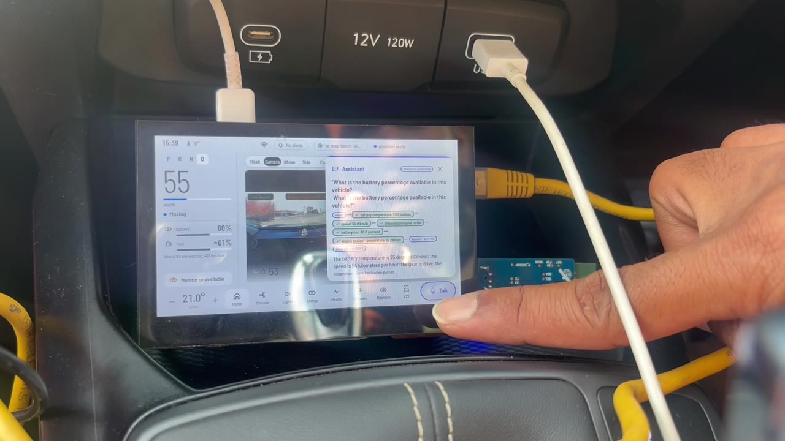
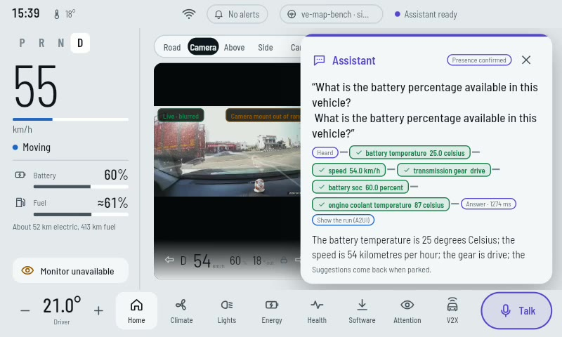
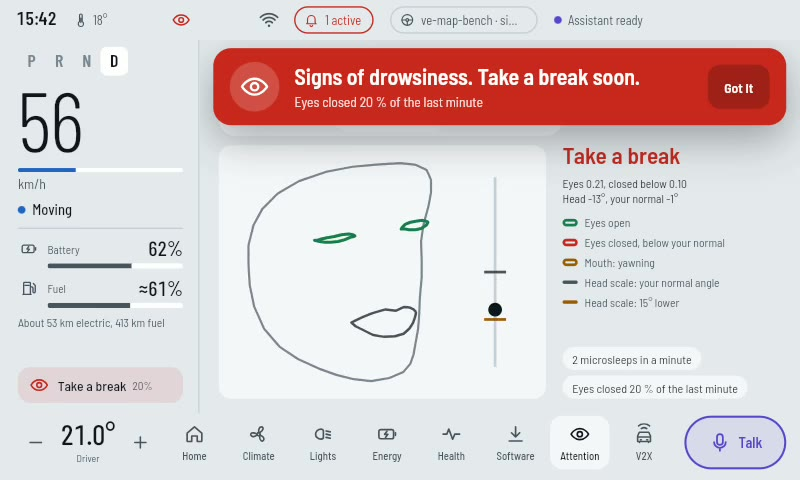
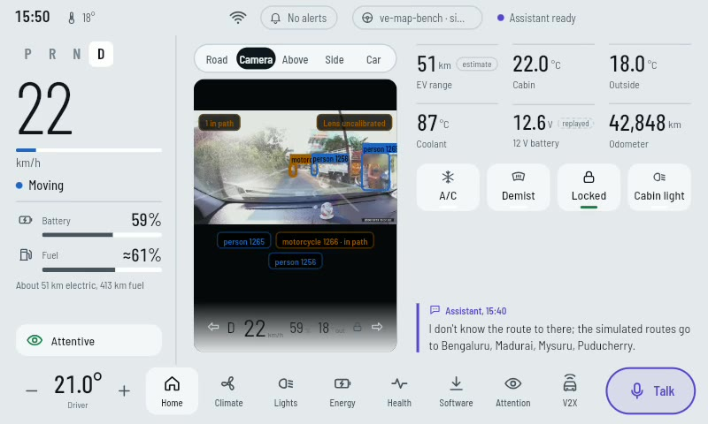

# Ve-AP — a governed AI agent in a real car

**Ve-AP** (Vehicle Agentic Platform), on the **VE-MAP** architecture · https://theschoolof.ai/ capstone project, 2026

> *Bounded authority and measured refusal for in-vehicle agents.*

▶ **Film:** [Watch on YouTube](https://www.youtube.com/watch?v=attTbTC4p-c) 
📊 **Slides:** [presentation/Ve-AP-capstone.pdf](presentation/Ve-AP-capstone.pdf)

An AI agent that answers questions about a car while it is being driven. It runs on two small boards in the
car, with **no cloud**. Every call it makes to the vehicle passes an **eight-condition authority predicate**.
Each condition can refuse on its own and names itself when it does. Every decision, refusals included, is
written to a **hash-chained journal** that can be checked afterwards. The agent reaches hardware only
through **MHS**, a hardware layer in which every device fact is checked data and no model ever speaks a
protocol.

## What is new

| | Idea | Shown |
|---|---|---|
| 1 | **`Allow(q)`, executed.** Eight conjuncts guard every vehicle call. Each one is made to deny on its own, with its own reason code, on every run | reachability **8/8** |
| 2 | **MHS: hardware as checked data.** Four questions kept apart (what · how · where · whether). A registry pinned by digest. Two locks: MHS *cannot* mint authority, and a device interlock can still refuse. Honest fallback. Leases that expire to a safe state | MHS suite **481 passed** |
| 3 | **Refusal by name.** Safety-critical capabilities are in no manifest; their names exist only so they can be refused | in every check |
| 4 | **Derived-state-only sensing.** The driver camera emits numbers, never a frame. The screen draws the face as lines | in the car |
| 5 | **Privacy-first road view.** Heads and number plates the detector finds are blurred before the picture leaves the computer. **No blur means no picture** | in the car |
| 6 | **Two paths.** Safety alerts are deterministic rules with no model. The agent may explain an alert, never clear it | bench |
| 7 | **The model is the last resort.** A small classifier (~130 ms warm) and a template answer most questions. Median **19.7 s → 0.86 s**, and every eval question still answers with the large model off | eval **12/12** |
| 8 | **Car audio arbiter.** A critical alert pre-empts a spoken answer (100 ms bound on the bench), and repeated warnings are rate-limited | pre-emption shown in the car, parked |
| 9 | **An AI-native SDLC with gates on the AI.** Pre-edit hooks stop the coding agent from breaking an invariant. Every test must fail first for its stated reason | 212 commits, 204 AI co-authored |

Full list, with an honest status for each, including the architecture's seventeen inventions:
[docs/03-innovations.md](docs/03-innovations.md).

## The system on one page

The layer that matters is **L4**, the capability gateway: the only way down. Models live above it, protocols
below it, and no CAN ID or diagnostic service number crosses it.

## In the car — 2026-10-19

| Ask the car | Drowsiness | Road view |
|---|---|---|
|  |  |  |
| Spoken question; the answer lists its evidence | Eyes closed → *"Take a break soon."*, with no image of the driver | Blurred dash cam, detections, *in path*, *lens uncalibrated* stated honestly |

**Real:** cameras, microphone, speech, car audio, both computers on battery. **Simulated:** the vehicle
signals, from a CAN simulator. The car's OBD-II port is the next stage. Details:
[docs/09-vehicle-testing.md](docs/09-vehicle-testing.md).

## Results at a glance

| Check (2026-10-19 unless noted) | Result |
|---|---|
| Offline check-all: 18 sections | **18 PASS · 0 FAIL** |
| Conjuncts that deny with their own code | **8 / 8** |
| Journal hash chain | **intact**, 1,950 decisions |
| Invariants I1–I7 | **all held** |
| Tests: T1 · MHS · SOVD · voice · vision · T4 · cabin | 983 · 481 · 104 · 335 · 121 · 146 · 278 passed |
| Answer eval (live) · with the large model off (10-12) | **12/12**, median 0.4 s · **11/11**, median 0.38 s |
| Road view in the car: three drives, 42 min | ~10 fps throughout; mount found in 74 s once the camera was straightened |

## Documents

| # | Document | What it covers |
|---|---|---|
| 01 | [Discussion](docs/01-discussion.md) | the problem, the thesis, the predicate, the design choices argued |
| 02 | [Design](docs/02-design.md) | layers, invariants, deployment, the gate, MHS, two paths, evidence, privacy |
| 03 | [Innovations](docs/03-innovations.md) | **MHS**, the executed predicate, the seventeen inventions, new ideas, each with its status |
| 04 | [Use cases](docs/04-use-cases.md) | every use case: in the car, bench, feature workflows, platform, alerts, refused by design |
| 05 | [Implementation](docs/05-implementation.md) | components, stack, reused vs built, the life of a request |
| 06 | [Setup](docs/06-setup.md) | hardware, wiring, bring-up, bench → car |
| 07 | [Testing](docs/07-testing.md) | tiers, fail-first, reachability, mutation gates, traceability, CI |
| 08 | [Unit and integration results](docs/08-unit-test-results.md) | every suite and eval, with dates |
| 09 | [Vehicle testing](docs/09-vehicle-testing.md) | the in-car results, and what did not work |
| 10 | [AI-SDLC](docs/10-ai-sdlc.md) | how it was built with an AI coding agent, inside gates |
| 11 | [Limits and future](docs/11-limits-and-future.md) | every limit in one place; the next ten steps |

Also: [diagrams](diagrams/) (mermaid sources, SVG, PNG) · [film storyboard](video/storyboard.md) ·
[privacy review of the footage](video/privacy-review.md).

## About this repository

The Ve-AP source code is private. This repository is the open record of the capstone: concept, design,
evidence and film. It contains no source code, credentials, network details or raw logs. Every number cites
the dated run it came from.

**Honest limits, in one line:** a simulated vehicle bus, a C0 (read-only) live permit, a journal that is
tamper-evident but not anchored, one car and one session, and no ISO 26262 / 21434 claim.
[More](docs/11-limits-and-future.md).

## Licence

© 2026 Yuvaraja. Documents, diagrams, slides, images and film are licensed under
**[CC BY-NC-ND 4.0](LICENSE)**: share with credit, non-commercially, without modification.
