# 02 · Design — layers, nodes, boundaries

Diagram sources are in [`../diagrams/src`](../diagrams/src). Each diagram has one sentence under it about the
edge that matters most.

## Part 1 — System context

**The edge that matters most:** *agent → Allow(q)*. The agent has no other route to the vehicle. Every call
goes through the gate, and so does every refusal, which is journalled.

## Part 2 — The layer model (VE-MAP)

Ten layers, L0 to L9. One boundary carries the weight: **L4, the capability gateway, is the only way down.**
Models and agents live above it, protocols below it. In the code this is enforced as invariants, not
convention:

| Invariant | Property |
|---|---|
| **I1** | No model or agent touches a vehicle interface. L4 is the only path from L5–L7 downward. |
| **I2** | Nothing above the operation port speaks a protocol. Only an L3 adapter does. |
| **I3** | L4 exposes **bounded semantic operations**: no service IDs, CAN IDs, shell strings or diagnostic service numbers in any capability signature. |
| **I4** | High-rate data (10–100 Hz) never crosses L4. L5 summarises first. |
| **I5** | Deterministic L0 controllers stay authoritative. No C3 capability in any manifest. |
| **I6** | Only an *admitted* execution path asks the signal broker to actuate, and only after the gate has admitted and journalled it. Only providers publish values. Publishing elsewhere would be lying about vehicle state. |
| **I7** | Providers are write-only into the broker. Nothing holds a provider handle: isolation is a missing import, not a filter. |

Each invariant has a test that runs on every check, and a pre-edit hook stops the development agent from
writing code that breaks it ([10](10-ai-sdlc.md)).

## Part 3 — Deployment: two boards in the car

| Node | Role |
|---|---|
| **Jetson Orin Nano Super** (compute) | the governed vehicle agent and its journal; fast-route classifier; voice (push-to-talk, speech-to-text, text-to-speech); driver monitoring; road view (object detector, openpilot lane model, privacy blur) |
| **Raspberry Pi 5** (vehicle node) | MHS core and registry; SOVD diagnostic server with MCP; KUKSA signal broker; CAN (simulator today, the car's OBD-II port next); cabin display; car audio arbiter; dash cam gateway |
| **GPU workstation** (optional) | a larger model for questions that need reasoning. **It is not in the car**: every in-car answer works without it |

**The edge that matters most:** *agent → SOVD/MCP over a direct Ethernet link*. The agent reaches the vehicle
node only through semantic capabilities. The vehicle node never asks the agent for anything.

## Part 4 — The gate: `Allow(q)`

Conjuncts are evaluated in order, and **the first one to refuse names the decision**. Admitted or refused,
the verdict is written to the journal before anything reaches a device. A write that is admitted is checked
afterwards by reading the value back, because the signal broker does not guarantee that an actuation lands.

## Part 5 — The hardware layer: MHS

MHS answers four questions and keeps them apart:

- **What:** the capability.
- **How:** the binding.
- **Where:** the adapter and interface.
- **Whether:** the admission check and the device interlock.

**Every hardware fact is data** in a registry that is checked when it compiles. The core serving it is
generic. [03](03-innovations.md) Part 1 covers MHS in full.

**The edge that matters most:** *faces → core*. The agent harness, MCP, the cabin display and the SOVD
diagnostic API are all consumers of one core. None of them speaks a protocol, so a new face adds no new path
to a device.

## Part 6 — Two paths

Path A raises safety alerts from declared rules, with no model. Path B is the agent. **The agent may explain
an alert, and can never clear or suppress one.** A model failure therefore cannot silence a warning.

## Part 7 — Evidence

Each decision line carries the hash of the line before it. The verifier recomputes the chain and reports any
edit, deletion or reordering, with its line number. The journal is **tamper-evident, not tamper-proof**: its
head is not yet anchored anywhere outside the machine.

## Part 8 — Autonomy classes

The class is the "risk" in `Risk(t,s) ≤ Permit(i)`. The live in-car agent's permit is **C0**. C3 names exist
in the code only so they can be refused by name.

## Part 9 — Privacy by construction

| Sensor | What leaves it | What never leaves it |
|---|---|---|
| Driver webcam | eyes-closed share, yawns, head angle, a face outline as 0..1 numbers | any image of the driver |
| Dash cam | a picture with the heads and number plates the detector finds blurred, at ≤ 10 fps; object boxes; lane lines | an unblurred frame. If blurring is unavailable, **no picture is sent at all** |
| Microphone | a transcript, and audio only while Talk is held | audio when Talk is not held, or wake-word listening while moving |
| GNSS | position, **only with the occupant's consent**. Without it the agent refuses `REDACTION_UNAVAILABLE` | — |

## Honest limits

- The physical vehicle layer (L0) is the real car, but the signals the agent reads in this build come from a
  **CAN simulator** on the Pi. The design reaches a real ECU only through the same capability names.
- L1 (runtime orchestration with containers) is only partly built. L9 (cloud) is designed and off.
- The journal is tamper-evident, not tamper-proof. The device interlock runs in the same process as MHS.
- The road-view blur covers what the detector finds. A face or plate the detector misses is not blurred.
