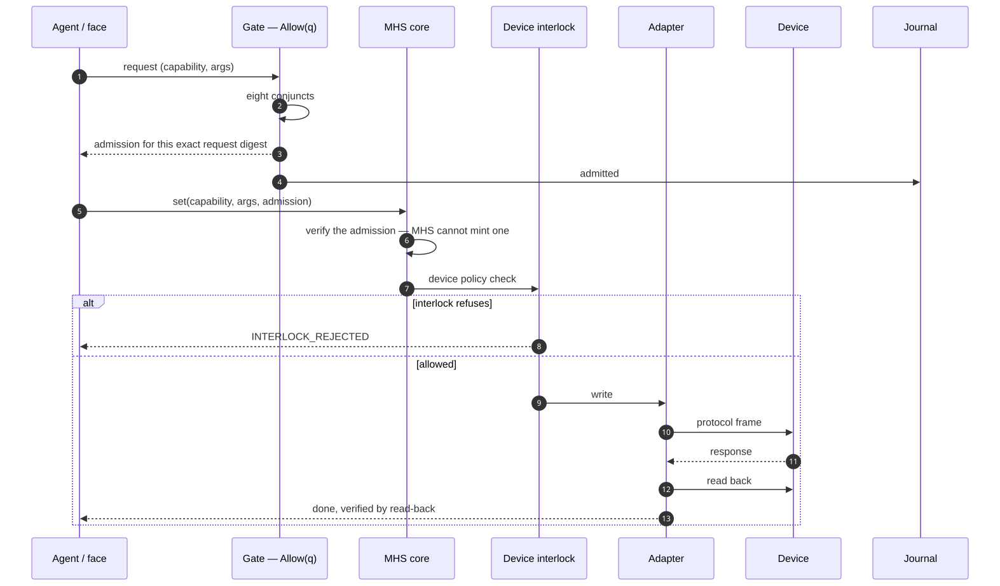

# 03 · Innovations — what is new, and how far each is built

Every claim below carries a status. **Built** means it runs live and a test exercises it. **POC** means it is
built and tested in the proof of concept, not on the live path. **Partial** means part of it is built.
**Design** means it is specified, with no code yet. An idea marked *Design* is a contribution of the
architecture, not of this build.

## Part 1 — MHS: hardware as checked data

**The problem.** Agent runtimes answer "what can I call?" with a tool list and leave the rest to code
written per device. Every new sensor becomes a new tool and a new code path, and nothing checks that a
fallback measures the same thing as the path it replaces.

**The idea.** MHS is a hardware layer where *every hardware fact is data* in a registry that is checked when
it compiles, served by a core that knows no vehicle, no board and no pin. **MHS decides no authority**: it
carries out only what a separate gate has admitted, and its device interlock can still say no. The name follows
a publicly announced model-hardware standard. MHS is aligned with it in shape only and claims no conformance,
because that specification is unpublished.

| MHS idea | What it means | Status |
|---|---|---|
| **Four questions kept apart** | *What* (capability), *how* (binding), *where* (adapter, interface), *whether* (admission + interlock). The agent never names a pin, CAN ID, signal path or diagnostic service | Built |
| **Registry as data** | Eight record types: interfaces, instances, resources, capabilities, bindings, interlock policies, lenses, controllers. One profile per node; domain and board knowledge come in as **packs**. The database is generated, never edited | Built (154 capabilities on the bench node, 0 callable C3) |
| **Compile rules with mutation tests** | Each rule has a test that breaks the registry on purpose and must turn the compiler red | Built |
| **Generic core** | A boundary test fails if a vehicle name, signal path or device node appears in core logic | Built |
| **The digest is the version** | A node imports another as an interface **pinned to its registry digest**. On a mismatch every call answers `REGISTRY_CHANGED` until an operator re-pins | Built |
| **Honest fallback** | A read falls back only to the *same quantity* at equal or better freshness. Writes never fall back. Freshness is recomputed in the core, never trusted from an adapter | Built |
| **Two locks** | The gate mints an admission for one exact request digest. MHS verifies it and *cannot mint one*, and with no verifier configured it fails closed. The device interlock can still refuse an admitted write | Built (interlock runs in the same process) |
| **Lenses and leases** | Live data leaves only through declared reductions with rate and byte budgets. Anything held over time is a lease that expires to a safe state. Control loops are declared, and the model only sets goals | Built |
| **One owner per device** | A device with one reader (for example a serial GNSS) has one owner process. The others read its snapshot, and a stale snapshot is refused | Built |
| **A one-line serial grammar** | `mhs-line/1`: COMMAND, CONTROL, STATE, STATUS, EVENT, ACK, each with a sequence number and checksum, and each class mapped to one MHS verb. Used by the bench panel firmware | Built |
| **Verbs, not tools** | discover, describe, status, explain (a dry run that matches the real decision), fetch, request, set, subscribe_lens, drain, renew, release. MCP gets 14 verbs, **never one tool per device** | Built |
| **One core, many faces** | The agent harness, MCP, the cabin display bridge (a disconnect releases every lease) and the SOVD diagnostic API all consume one core | Built |

**MHS reason codes.** Each fault is a named refusal, never a traceback:

| Code | Means |
|---|---|
| `CLOCK_SKEW` | a value's timestamp is in the future |
| `TIMESTAMP_MISSING` | a value arrived with no timestamp |
| `INTERLOCK_REJECTED` | the device policy refused a write that the gate had already admitted |
| `DEVICE_REFUSED` | the device answered negatively |
| `LEASE_EXPIRED` | a lease was renewed after its time-to-live |
| `LEASE_LIMIT` | one lease more than the principal may hold |
| `CONTROLLER_HALTED` | a control loop stopped on stale input |
| `REGISTRY_CHANGED` | the pinned digest no longer matches |

MHS was extracted into a standalone repository with its own paper draft. Evidence: the MHS suite, **481
tests passed** (2026-10-19).

## Part 2 — An executed authority predicate

| Idea | Status |
|---|---|
| **Eight conjuncts, each independently deniable, each naming itself.** `Allow(q)` guards every vehicle call the live agent makes | Built: a reachability run makes each conjunct refuse with its own code, **8/8** |
| **Refusal as evidence.** Every verdict, refusals included, is a line in a hash-chained journal with a verifier | Built: 1,950 decisions verified intact (2026-10-19). Tamper-evident, not anchored |
| **A command is refused before any model runs.** A C3 name is refused by name | Built |

## Part 3 — The seventeen inventions of the architecture

Each was argued in its own intent and specification. As far as this project's literature survey found, none
appears in published products or research as of 2026. That is a claim about our survey, not a guarantee.

| # | Invention | Idea in one sentence | Status |
|---|---|---|---|
| 1 | Authority-routed inference | Choose the model by what its answer is *permitted to do*, not by its size or speed | Partial: commands and C3 are refused before any model runs |
| 2 | The Speak predicate | Speaking without being asked must pass an admissibility check shaped like the one for acting | POC |
| 3 | Refusal counterfactual | Replay each denied action on a digital twin and report a prevented-harm rate | Design |
| 4 | Signed offline capability manifest | Know what a tool does before connecting to it | Partial: digest pinning built, signing not |
| 5 | Joules per answer | Energy as a first-class cost of every answer | Design |
| 6 | Portable evidence receipt | A record a third party can verify without us | Partial: hash chain and verifier built, not signed or anchored |
| 7 | Negative-answer accountability | "Why did you not tell me?" answered from the record | Design: refusals are journalled, no query yet |
| 8 | A2UI inside the vehicle | In the car, UI is data from a closed catalogue, never code | Partial: in-car half built |
| 9 | Shadow gate on verdict sequences | Compare `[refuse, allow, needs_approval]` sequences, not prose | Design: baselines exist, not wired |
| 10 | Conflict arbitration | A named rule decides between agents, and the loser is told why | Design: one agent by choice |
| 11 | Motion-state widget legality | A control that is legal parked is illegal at speed | Partial: parked-only controls refuse `WIDGET_NOT_PERMITTED_IN_MOTION` |
| 12 | A generated tool is a proposal | Discovered hardware arrives as a *proposal* that a human must classify | Partial: MHS probe drafts are invisible to agents until classed |
| 13 | The plan is not the authority | Every step of an approved plan re-enters the gate; approval covers the plan, never the actions | Partial: every live step re-enters `Allow(q)` |
| 14 | **Derived-state-only sensing** | The driver camera emits bounded numbers, never a frame | **Built**, shown in the film |
| 15 | Grammar-bounded tool calling | The admitted manifest becomes the decoding grammar | Partial: strict schemas built; decoder mask not built |
| 16 | Signed model slots with A/B rollback | The A/B update pattern applied to model weights | Design: only a development gate exists |
| 17 | **Presence button as push-to-talk** | The press that proves presence for C2 is the press that opens the microphone | Partial: push-to-talk live, presence-as-approval in the POC |

## Part 4 — New ideas that came from building it

| Idea | What it is | Status |
|---|---|---|
| **Fast route** | A small classifier (~130 ms warm) picks the one reading a question needs, and a template answers with no language model. Median answer **19.7 s → 0.86 s** | Built, on by default |
| **Fast-turn ladder** | no model → small classifier → larger model. Every eval question still answers when the larger model is unreachable (12/12) | Built |
| **Two paths** | Deterministic alerts with no model. The agent may explain an alert and can never clear one | Built |
| **SOVD north face over MHS** | A standard diagnostic REST API (ASAM SOVD style) and MCP on one server, both consumers of MHS | Built |
| **Road-camera privacy** | Heads and number plates the detector finds are blurred before the picture leaves the Jetson, and **no blur means no picture**. Our own bonnet is filtered out. The camera mount is found by driving | Built, live with the dash cam; lens not yet calibrated |
| **Car audio arbiter** | A critical alert cuts a spoken answer (a 100 ms bound, tested on the bench), repeated warnings are rate-limited, and stale answers are dropped | Built; pre-emption and the rate limit shown in the car, parked |
| **Feature workflows** | Health, diagnostics, breakdown and trip questions answered with a structured report: findings, possible causes, **readings it could not take, said rather than hidden**, and off-vehicle proposals | Built for 4 features; service and ownership not built |
| **A face drawn as lines** | The cabin screen draws the driver's face from 0..1 outline numbers, never from pixels | Built, shown in the film |
| **Gates on the developer** | Pre-edit hooks stop the AI coding agent before it writes code that breaks an invariant ([10](10-ai-sdlc.md)) | Built, probed both ways in CI |

## Honest limits

- Of the seventeen inventions, one is fully built (14). Nine are partial; 17's push-to-talk half, for example,
  is live. One is POC only and six are design only. The architecture argues for all seventeen; this build
  proves only the ones marked.
- "Built" means tested on the bench and, where the film shows it, in the car with a simulated vehicle bus. It
  does not mean validated for production.
