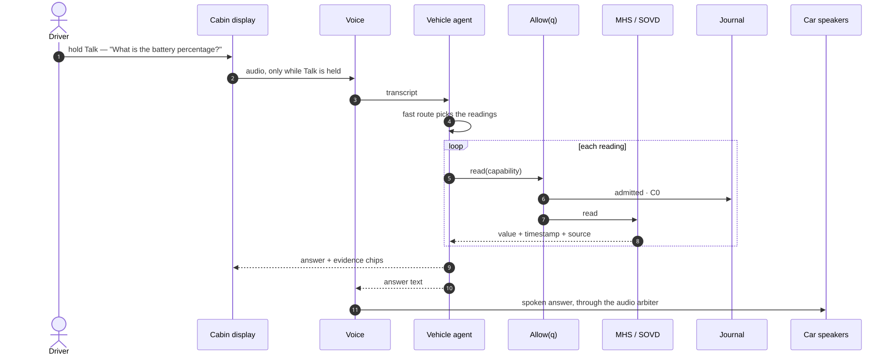
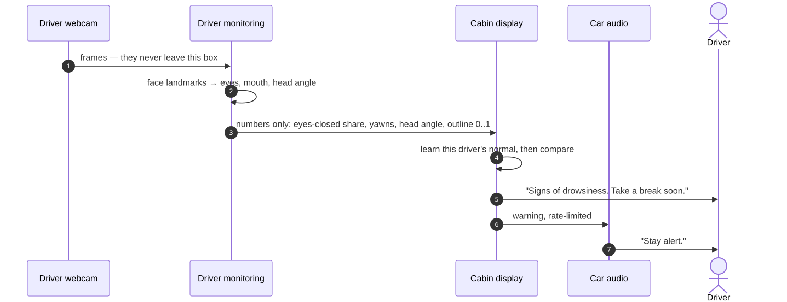
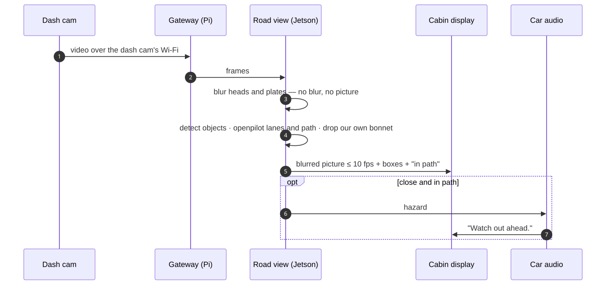
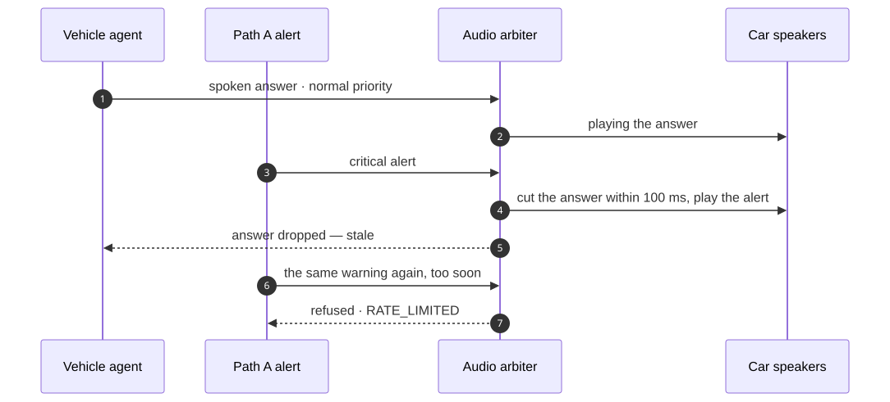
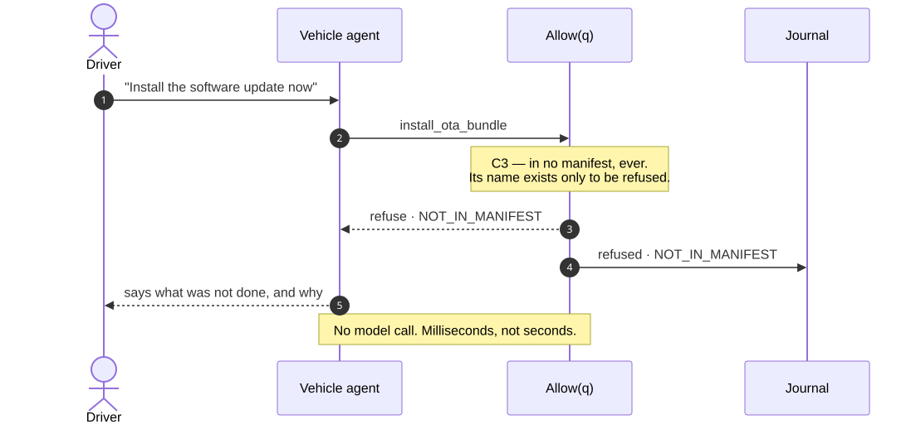
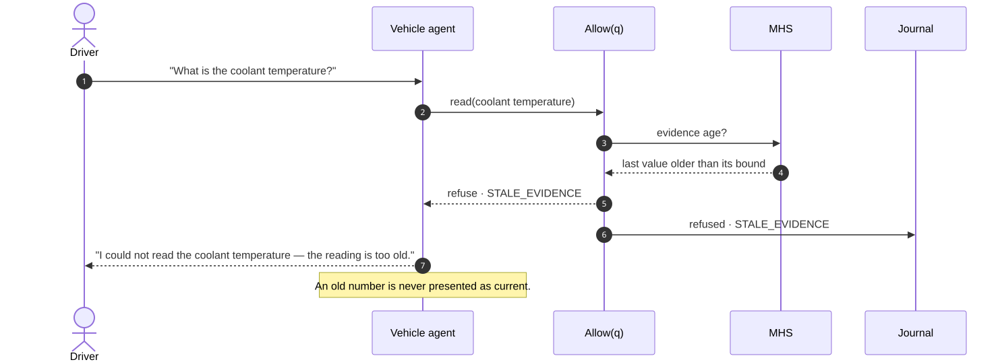
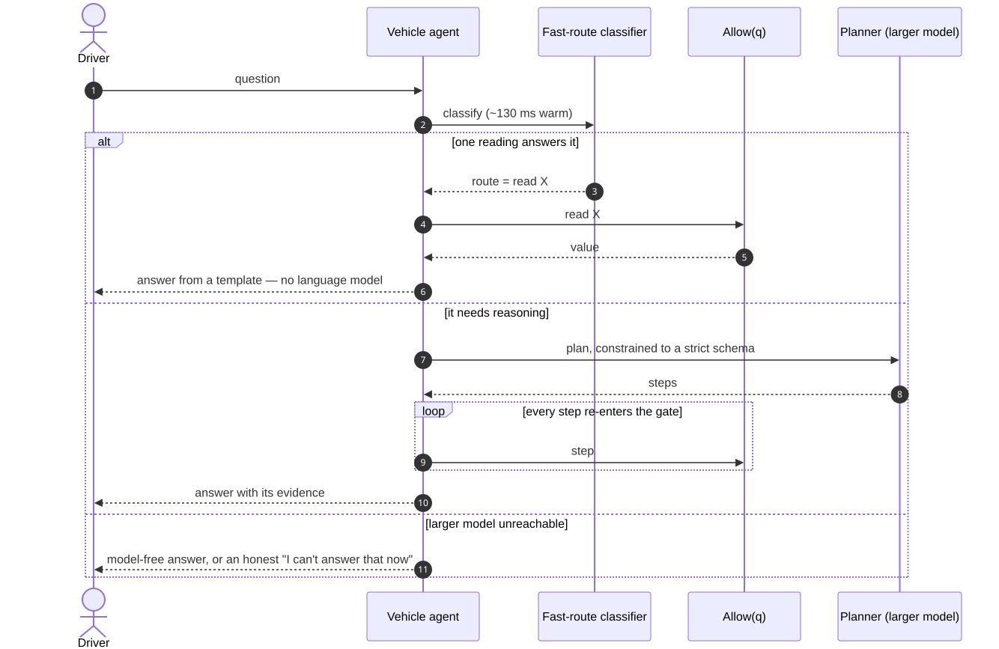

# 04 · Use cases

Grouped by where each was shown. **In the car** means it was recorded on 2026-10-19 and appears in the film (times are film timestamps).
**Bench** means it was tested on the desk rig. **Specified** means it is designed, with no code yet.

## Part 1 — Shown in the car

| # | Use case | What happens | What is guaranteed | Film at |
|---|---|---|---|---|
| V1 | **Bring-up** | One command starts both boards and prints the health of every service, face and device | A device that is missing or faulty is *named*, never hidden. On the day: GNSS had no fix, and the panel was disconnected | 2:19 |
| V2 | **Ask the car by voice** | Hold Talk and ask. The answer is shown with its evidence and spoken through the car's speakers | Every reading passes `Allow(q)` and is journalled. Each answer lists the readings it used | 6:00 |
| V3 | **Refuse to invent** | Asked about an ongoing trip with no route set, the agent says it does not know the route and lists the routes it does know | An unsupported answer is not invented | 7:26 |
| V4 | **Drowsiness warning** | The monitor learns this driver's normal, then judges eye closure, yawns and head angle against it. *"Signs of drowsiness. Take a break soon."* | No frame of the driver leaves the Jetson. The screen draws the face as lines | 3:15, 7:54 |
| V5 | **Road view** | The dash cam's picture reaches the cabin screen blurred, with object boxes, the openpilot lane model and an *in path* flag | No blur means no picture. *Lens uncalibrated* is shown, not hidden | 4:30, 9:21 |
| V6 | **Car audio** | Answers and warnings play through the car's own speakers over Bluetooth | A critical alert pre-empts an answer, and repeated warnings are rate-limited (tested parked) | 6:00, 7:54 |
| V7 | **Cabin pages** | Home, climate, lights, energy, health, software, attention, V2X | Parked-only controls refuse while moving (bench-tested) | 7:33 |

## Part 2 — On the bench

| # | Use case | What happens | What is guaranteed |
|---|---|---|---|
| B1 | Ask the car by voice | Push-to-talk; partial text streams while you speak; the final transcript arrives on release | Audio never leaves the Jetson; no listening without the press |
| B2 | Drowsiness warning | A six-second baseline, then eye closure, microsleeps, head drops and yawns. The warning clears step by step | Numbers only |
| B3 | See the evidence | The attention screen shows the measured outline, this driver's thresholds and recent events | No image on the display |
| B4 | Climate and lights | A tap sends a request to the gate. The control shows a dashed outline until the read-back confirms | Actuating and publishing have separate owners; the display does neither |
| B5 | Fault codes | Codes are read and explained. Clearing them needs the car parked and a deliberate hold | C2: presence and stationary, otherwise refused with a code |
| B6 | **Refusal by name** | Asking for a C3 capability (the cabin camera image, raw CAN) is refused with `NOT_IN_MANIFEST` and its name | A refusal that can be tested, instead of a missing feature |
| B7 | **Stale data** | A signal that stops arriving is hatched, with no number shown. A stale speed never reads as *parked* | `STALE_EVIDENCE`; no made-up values |
| B8 | Display Wi-Fi | Network details. Joining a network needs the car parked | `WIDGET_NOT_PERMITTED_IN_MOTION` |
| B9 | Software status | Versions and update state | There is no install path, by construction |

## Part 3 — Feature workflows

A question about the car's health, faults, a breakdown or a trip gets a structured **feature report**:
findings, possible causes (never "certain"), **the readings it could not take, with their codes**, a
recommendation, and off-vehicle proposals that the driver approves. Every feature also answers with the
model switched off.

| Feature | Asked like | Status |
|---|---|---|
| Vehicle health | "Is the 12 V battery OK?", "check the car" | Built; bench: weak-battery scenario answered in under 1 s, with an inspection booking approved |
| Diagnostic investigation | "Investigate the fault", "intermittent" | Built; an intermittent fault is counted each time it returns |
| Breakdown | "The car won't start" | Built; location is withheld without consent, and the answer says so |
| Trip readiness | "Can I reach …?" | Built; route, weather and chargers are labelled mocks |
| Service coordination | "Book a service" | Not built |
| Ownership | "Warranty", "service history" | Not built |
| Connectivity | "The car is offline" | Specified (UC1 below) |
| OTA campaign | "The update failed" | Specified. **Installing is C3 and refused**; only campaign records can be read |

A command hidden inside a question ("…and clear the codes") is answered with the report **plus** a refusal
that names what was not done and why. It is never dropped silently.

## Part 4 — Platform use cases (specified)

| # | Use case | Why it matters |
|---|---|---|
| UC1 | Connectivity self-recovery | The only use case that makes a **real change to real hardware** (the network stack). It exercises the whole chain: authenticate, prove presence, issue a single-use writ bound to the request, admit, change, **verify**, journal. That chain is proven in the proof of concept |
| UC2 | Guided diagnostic sequences | Every step of an approved sequence re-enters the gate. The approval covers the plan, never the actions |
| UC3 | OTA pre-flight and software health | Read and explain update state. Installing is C3 and never in a manifest |
| UC4 | DMS warning explanation | "Why did you warn me?", answered from derived state and the record |

## Part 5 — Alerts

| Path A (deterministic, no model) | Path B (agent, may explain) |
|---|---|
| coolant hot · door open while moving · seat belt unfastened · brake fluid low · traction battery hot | low fuel · ice risk · battery sag |

## Part 6 — Refused by design (C3)

`send_can_frame` · `stream_forward_camera_raw` · `write_ecu_memory` · `install_ota_bundle` · `get_cabin_frame`
· `identify_driver` · `read_emotion` · `detect_smoking` · `identify_speaker` · `store_audio` · `detect_stress`

These names appear in no manifest. They exist only so a request for them is refused **by name**.

## Honest limits

- In the car, the vehicle signals behind V2 (battery %, speed, coolant, fault codes) came from the CAN
  simulator, and the screen marks them *estimate* / *replayed*. The cameras, microphone, speech and car audio
  were real.
- C2 use cases (B5, UC1) are proven in the proof of concept. The live agent holds a C0 permit.
