# 07 · Testing — strategy

**The rule:** *a test that has never failed proves nothing.* Every behaviour is built in this order:

1. requirement;
2. a test that names its reason code;
3. **run the test; it must fail for the stated reason**;
4. minimal code;
5. the test passes;
6. reachability;
7. mutation gate;
8. commit.

## Part 1 — Tiers

| Tier | Runs on | Proves |
|---|---|---|
| **T1** | any machine | pure logic: the predicate, MHS, providers, NMEA, bridges, packaging |
| **T2** | the Jetson | host facts: sysfs, network manager, power rails |
| **T3** | virtual CAN + ECU simulator | bus and diagnostics behaviour |
| **T4** | governed | the agent end to end against fakes: routing, guard decisions, journal |
| **T5** | two or more nodes | topology |
| **T6** | recorded corpus | shadow evaluation |

Every test states its tier. **A tier that cannot run skips with its reason, never a silent pass**, and a
check makes sure of it. A silently skipped hardware tier is the `ceiling triggered: 0` mistake in a different
costume.

## Part 2 — Reachability: every conjunct must deny

For each of the eight conjuncts of `Allow(q)`, a scenario is built in which **only that conjunct** fails. The
run passes only if the guard refuses with **that conjunct's code and no other**. A conjunct that never denies
in this run is reported as such, not counted as a pass.

## Part 3 — Mutation gates

A rule is proven only when breaking it on purpose turns a test red:

- **Cabin display:** a script breaks each UI rule in turn: motion lockout, alert precedence, stale hatching,
  gate outline. A test must fail each time.
- **MHS registry:** each compile rule is broken in a copy of the registry, and the compiler must reject it.
- **Car audio:** each audio rule was broken by hand to prove its test goes red. Examples: pre-emption, the
  rate limit, dropping stale answers.
- **Development gates:** every pre-edit gate is probed both ways, a forbidden edit and an allowed one, in CI.

## Part 4 — Traceability

Every requirement is linked to its intent, its work package, its plan task, its test and the reason code that
test provokes. A checker breaks the build on any gap. A new reason code needs three things: the enum entry,
the traceability entry, and a test that provokes it.

## Part 5 — Evaluations

| Eval | What it does |
|---|---|
| **Answers** | 12 driver questions, each scored on content and latency, run against the live agent |
| **Reachability** | one case per conjunct (Part 2) |
| **Verdict sequence diff** | compares recorded `[refuse, allow, …]` sequences with a baseline. *Baselines exist; not yet wired to the live guard* |
| **Turn stress** | sequential, paired and parallel sessions: answer order, stale answers, concurrency |
| **Box-down** | every answer eval runs again with the workstation model switched off |

## Part 6 — Live and in-car checks

- **Full feature test:** drives the running system over its real interfaces, feature by feature. Example
  checks: services, faces, agent answers, a capability sweep (allowed versus refused as declared), CAN speed,
  GNSS diagnosis, console. It produces one report.
- **Check-all:** every offline suite and checker in one run, with one report.
- **In-car evidence:**
  - a **numbers-only drive log** from the road view: frame rate, lane probabilities, lead car, boxes in
    path, mount calibration;
  - a written hand-back for car audio: what was heard, what failed, what was fixed;
  - the film.

## Part 7 — CI

Every push runs nine jobs:
- tiers T1 and T2;
- evaluations;
- traceability;
- message catalogues;
- MHS, with both registries checked;
- the SOVD server suite;
- the Jetson bridges;
- the cabin display (`flutter analyze` + widget tests);
- the gate probes.

T3–T6 skip in CI with their reasons written into the job summary.

## Honest limits

- The process review's update of 2026-09-21 recorded that no gate had yet caught a real regression, only its
  own probe. That has not been re-measured since.
- T5 and T6 have few tests. The verdict-diff evaluation is pending.
- The in-car checks are an evidence log and a film, not an automated in-vehicle test suite.
