# 10 · How it was built — an AI-native SDLC

Ve-AP was built by one engineer working with an AI coding agent (Claude Code). The project's subject is
*bounded authority for agents*, and the development process was held to the same idea: **the coding agent
worked inside gates it could not edit its way around**, and every claim had to be backed by a test that
had failed first.

> The project's own process review (2026-09-19) named the gap: *"a project about authority gates that has
> no authority gates on its own development"*. The process was rebuilt that week.

## Part 1 — The loop

| Stage | Artefact | Rule |
|---|---|---|
| **Plan** | `INTENT-nnn`: the problem, who it is for, and **the refusal it makes possible** | every incident opens an intent |
| **Design** | a specification in numbered parts, with diagrams and their load-bearing edges, ending in **Honest limits** | superseded text is struck through with a date, never deleted |
| **Build** | an executable plan of tasks with tests first, for any large work package | no large work package without a plan |
| **Test** | a test naming its reason code, which **must fail for the stated reason** before any code is written | a test that has never failed proves nothing |
| **Gate** | reachability, mutation gate, traceability, CI | a tier that cannot run skips with its reason |
| **Commit** | a local checkpoint after each green step, staging only that step's files | the human pushes; the agent never does |
| **Maintain** | metrics from the journal; a learnings file; status and plan files | a refusal that never fired becomes a new intent |

## Part 2 — Files are memory, not context

An AI agent forgets between sessions, so the project kept its memory in files:

| File | Purpose |
|---|---|
| Project instructions | layers, invariants, the predicate, commands, pitfalls. Loaded every session |
| **STATUS** | where things stand, under 60 lines. **Read first, every session**; overwritten, not appended |
| **PLAN** | the current steps, ticked as each goes green |
| **LEARNINGS** | every lesson that cost time: bench, models, agent, testing, git, mistakes |
| Traceability map | intent → requirement → work package → plan task → test → reason code |

**Working rules:**
- One session is one logical unit of work.
- Anything over about five files is split into steps first.
- Searches, log reading and reviews go to sub-agents, so only their summaries enter the main context.

## Part 3 — Gates on the coding agent

A **pre-edit hook** inspects every file the agent is about to write, and denies the edit if it would break an
invariant:

| Gate | Blocks |
|---|---|
| G1 | the gate or journal importing CAN or MCP code |
| G2 | anything but derived state leaving driver monitoring (no frame escapes) |
| G3 | a C3 capability in any manifest |
| G4 | a flash path: anything that installs firmware or writes a block device |
| G5 | an unsigned model slot, or one without a card |
| G6 | a push to the main branch |
| G7 | a cloud SDK outside the depot; actuation outside an admitted path; value publishing outside the providers |
| G8 | service, CAN or diagnostic IDs in a capability signature |

The gates are probed **both ways in CI**. A forbidden edit must be denied and an allowed one must pass, so a
gate cannot silently decay into a no-op.

## Part 4 — Skills, sub-agents and review

| Kind | Name | Does |
|---|---|---|
| Skill | add a conjunct | conjunct + reason code + reachability scenario + mutation gate, together or not at all |
| Skill | add a capability | manifest class, schema, refusal test, operation-port call |
| Skill | spec to plan | turns a spec section into an executable, test-first plan |
| Sub-agent | conjunct prover | writes the failing test and scenario, and reports whether the conjunct denied **for its own reason only** |
| Sub-agent | seam conformance | checks that a provider or operation-port implementation meets the shared contract |
| Command | capstone review | maps every hunk of a diff to an invariant, a work package and a reason code |

## Part 5 — The numbers

| | |
|---|---|
| Duration | 2026-09-03 → 2026-10-19 |
| Commits | **212**; **204** carry the AI co-author trailer |
| Commits by month | 8 in September, 204 in October |
| Intents / specs / plans | 54 / 47 / 10 |
| Traced requirements | 424 (2026-10-19), each with a test and a reason code |
| Reason codes | 45, each provoked by a test |
| Process plays (of 12) met on 2026-09-19 | 2 met, 3 partial, 7 missing. Two days later, 10 of the 12 process work packages were built |

## Part 6 — What the human did, and what the AI did

| The human | The AI agent |
|---|---|
| chose the problem and the architecture; approved every intent and spec | drafted specs and plans; wrote tests first, then code |
| did every physical action: wiring, button presses, driving | never simulated a physical bench action (a button press, a wire) in software, and never asked for one unless the human said they were at the bench |
| pushed to GitHub; decided branches and releases | made local checkpoint commits of exactly the files in a step |
| judged what was good enough | reported failures with their output, and kept honest limits in every spec |

## Part 7 — Lessons the process recorded

- **A failing-first test must fail for the stated reason.** Two of six "failing-first" tests passed at once.
  One was a guard; the other had not reproduced the defect and had to be rewritten.
- **When a probe finds nothing, suspect the probe.** A bridge check read the wrong field name and reported a
  working link (812 frames in 10 s) as dead.
- **Verify a service through its own socket**, never through a script that borrows your path. A shared
  library was found through the tests' path but not the service's. The service crash-looped 1,566 times
  while an ad-hoc check said everything was fine. Two guards came out of it: a test that every adapter
  imports, and a packaging test.
- **One owner per device has to be enforced, not intended.** An "exclusive" serial open on one side protected
  nothing; two readers each got half the sentences.
- **A fixture can outrank real hardware.** A hard-coded simulated position had a higher priority than the
  real receiver. When a device arrives, remove what was standing in for it.
- **The context window is not memory.** Scratch files did not survive a context compaction; anything a later
  step needs goes in the repository.
- **Never diagnose from an action that did not happen.** An early session diagnosed a wiring fault from a
  button press the human never made.

## Honest limits

- The commit history shows co-authorship, not a split of effort. Design decisions, physical work and
  acceptance were the human's.
- The gates check what can be checked statically before an edit. They do not replace review, and the process
  review records that none has yet caught a real regression outside its own probe.
- The metrics come from one engineer on one project. They are not a controlled study.
